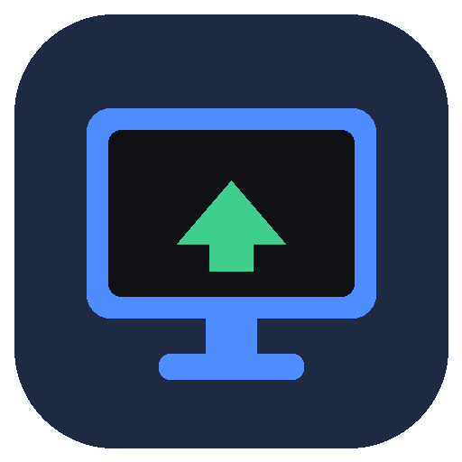
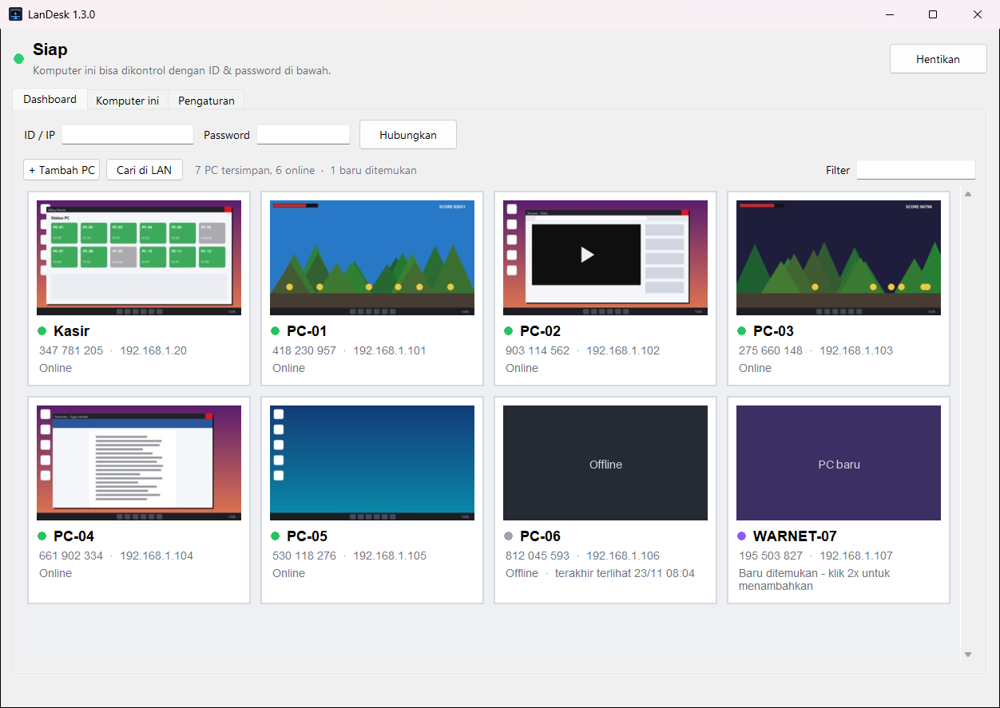
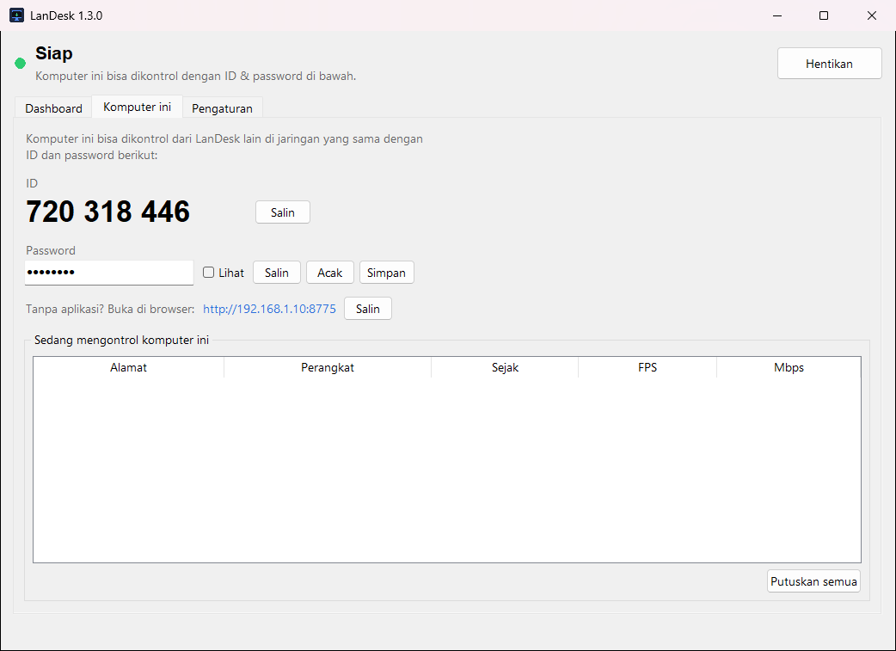
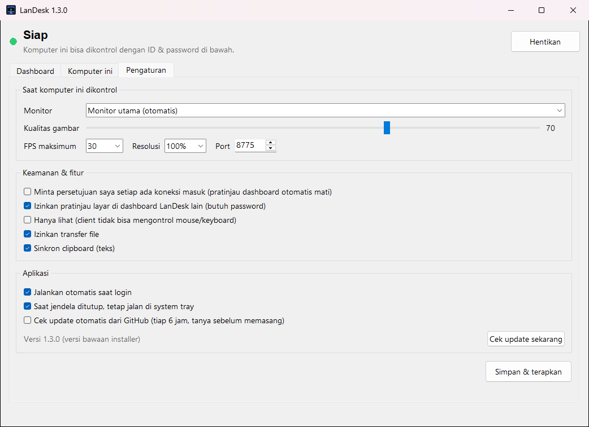

<div align="center">



# LanDesk

**Remote desktop ringan khusus jaringan lokal untuk Windows & Linux.**
Satu aplikasi untuk mengontrol PC lain *dan* dikontrol, dengan dashboard pratinjau layar semua PC.

*Lightweight LAN-only remote desktop for Windows & Linux: live-preview dashboard, file transfer,
clipboard sync and auto-update. No cloud, no relay server.*

[](https://github.com/nurfatoni-beep/landesk/releases/latest)
[](https://github.com/nurfatoni-beep/landesk/actions/workflows/release.yml)
[](https://github.com/nurfatoni-beep/landesk/releases)

[](LICENSE)

[**⬇ Download**](https://github.com/nurfatoni-beep/landesk/releases/latest) ·
[Fitur](#fitur) ·
[Instalasi](#instalasi) ·
[Cara pakai](#cara-pakai) ·
[Update otomatis](#update-otomatis) ·
[Keamanan](#keamanan)



</div>

---

## Kenapa LanDesk?

- **Cepat**: lewat LAN langsung, tanpa server perantara. Hanya bagian layar yang berubah yang
  dikirim; layar diam = ±0 byte.
- **Aman secara desain**: tidak ada koneksi ke internet atau cloud. Data tidak keluar dari jaringan
  lokal Anda.
- **Cocok untuk warnet, lab komputer, kantor kecil**: semua PC tampil dalam satu dashboard,
  tinggal klik dua kali untuk mengontrol. Tidak perlu menghafal ID.
- **Tanpa admin**: installer Windows per-user, lolos Smart App Control. Update otomatis tanpa admin.

## Fitur

| | |
|---|---|
| 🖥️ **Dashboard** | Semua PC dalam satu layar dengan **pratinjau layar live**: PC tersimpan, ditambahkan manual, atau ditemukan otomatis di LAN. Status online/offline, ganti nama kartu ("PC-01", "Kasir"), filter, dan IP DHCP yang berubah dikenali otomatis lewat ID. |
| 🔑 **ID + password** | ID 9 digit permanen per komputer (seperti RustDesk). Password bisa diganti atau dibuat acak. Opsi *pakai password ini untuk semua PC baru*. |
| 🔍 **Pencarian otomatis** | LanDesk lain di LAN langsung muncul. Bisa juga konek pakai ID atau alamat IP. |
| 🪟 **Viewer** | Jendela sendiri (Edge/Chrome mode aplikasi). Pilih monitor (atau gabungan semua monitor), kualitas, FPS, skala, fullscreen dengan Keyboard Lock (Alt+Tab, Win, Esc ikut terkirim), dan menu tombol khusus (Ctrl+Shift+Esc, Win+R, Alt+F4, Print Screen, dll). |
| 📋 **Clipboard** | Sinkron teks dua arah, otomatis. |
| 📁 **Transfer file** | Jelajah folder host, unduh, kirim, atau **drag & drop file ke layar remote**. |
| 🛡️ **Keamanan** | Token sekali pakai, opsi **minta persetujuan** untuk tiap koneksi masuk, mode hanya-lihat, file/clipboard/pratinjau bisa dimatikan, login gagal diperlambat. |
| 🔄 **Update otomatis** | Cek rilis GitHub, tanya dulu, pasang paket ±50 KB, restart. Gagal start → otomatis kembali ke versi lama. |
| 🧩 **Lainnya** | System tray, notifikasi, jalan otomatis saat login, satu instance per PC, dan tanpa aplikasi pun bisa dibuka di browser apa saja: `http://<ip-host>:8765`. |

<table>
<tr>
<td width="50%"></td>
<td width="50%"></td>
</tr>
<tr>
<td align="center"><sub>Tab <b>Komputer ini</b>: ID & password untuk dikontrol</sub></td>
<td align="center"><sub>Tab <b>Pengaturan</b>: kualitas, keamanan, update</sub></td>
</tr>
</table>

## Instalasi

Unduh dari **[halaman rilis terbaru](https://github.com/nurfatoni-beep/landesk/releases/latest)**:

| File | Untuk |
|---|---|
| `LanDesk-x.y.z-win64-portable.zip` | **Windows 10/11 (disarankan)**: ekstrak, lalu double-click `Install.cmd`. Lolos Smart App Control, tidak butuh admin. |
| `LanDesk-Setup-x.y.z-win64.exe` | Windows tanpa Smart App Control (installer biasa). |
| `landesk_x.y.z_all.deb` | Ubuntu 22.04+ / Debian 12+ / Linux Mint 21+. |

<details>
<summary><b>Windows: detail</b></summary>

- **Zip + `Install.cmd`** memasang ke `%LOCALAPPDATA%\Programs\LanDesk`, membuat shortcut Start
  Menu/Desktop, dan entri uninstall di *Settings → Apps*. Klik kanan → *Run as administrator*
  supaya rule firewall (TCP 8765 + UDP 8766) dibuat otomatis; kalau tidak, klik *Allow* saat
  Windows Firewall bertanya.
- **setup.exe** belum ditandatangani digital: SmartScreen menampilkan *"Windows protected your PC"*
  → *More info* → *Run anyway*. Di PC dengan Smart App Control setup.exe diblokir; pakai zip.
- Paket Windows **tidak berisi exe buatan sendiri**. Aplikasi dijalankan oleh `runtime\pythonw.exe`
  (Python resmi, ditandatangani Python Software Foundation), library PyPI di `lib\`, dan kode di
  `app\`. Viewer memakai Microsoft Edge bawaan Windows.

</details>

<details>
<summary><b>Ubuntu / Debian: detail</b></summary>

```bash
sudo apt install ./landesk_*_all.deb
sudo ufw allow 8765/tcp && sudo ufw allow 8766/udp     # kalau ufw aktif
```

Buka **LanDesk** dari menu aplikasi. Viewer memakai Chromium/Chrome/Edge kalau ada (kalau tidak,
browser default tanpa sinkron clipboard otomatis). Sinkron clipboard butuh `xclip` (ikut terpasang
sebagai *Recommends*). Uninstall: `sudo apt remove landesk`.

> Untuk **dikontrol**, butuh sesi **Xorg** (pilih *Ubuntu on Xorg* di layar login). Wayland belum
> didukung.

</details>

## Cara pakai

1. Pasang dan buka **LanDesk** di semua komputer dalam satu LAN.
2. Di komputer yang mau dikontrol, tab **Komputer ini** menampilkan **ID** dan **password**.
3. Di komputer operator, buka tab **Dashboard**. PC lain muncul otomatis sebagai kartu *PC baru*.
   Klik dua kali, isi password sekali, dan PC itu tersimpan dengan pratinjau live.
4. Viewer terbuka. Gerakkan mouse ke **tepi atas** untuk memunculkan toolbar (📌 untuk menempelkannya).

> **Contoh warnet:** samakan password LanDesk di semua PC client (tab *Komputer ini* → ketik
> password → *Simpan*). Di PC operator, klik dua kali satu kartu *PC baru*, isi password, centang
> *pakai password ini untuk semua PC baru*. Semua PC langsung tampil dengan pratinjau. Ganti nama
> kartu sesuai nomor meja lewat klik kanan → *Ganti nama*.

## Update otomatis

LanDesk mengecek [rilis GitHub](https://github.com/nurfatoni-beep/landesk/releases) 20 detik
setelah start, lalu tiap 6 jam. Kalau ada versi baru:

- Muncul bar kuning *"Update LanDesk x.y.z tersedia"* dan notifikasi tray.
- **Pasang & restart**: mengunduh paket kecil (±50 KB), memverifikasi SHA-256, lalu memulai
  ulang. Tidak butuh admin/sudo.
- **Nanti**: versi itu tidak ditawarkan lagi sampai ada versi yang lebih baru.
- Kalau versi baru gagal start, LanDesk otomatis kembali ke versi bawaan installer.
- Kalau ada perubahan library (`requirements.txt`), bar meminta pasang ulang paket lengkap.

Bisa dimatikan di *Pengaturan → Aplikasi*. Untuk jaringan tanpa akses GitHub, isi `update_feed`
di config dengan URL `latest.json` di server LAN (buat dengan
`python packaging/make_update.py --base-url http://server-lan/landesk`).

## Kenapa cepat

```
 [LanDesk A]  -- UDP 8766: "siapa saja yang ada?" -->  [LanDesk B]   pencarian otomatis
 [LanDesk A]  -- POST /api/token (password) ------->   [LanDesk B]   token sekali pakai
 [Viewer A ]  == WebSocket TCP 8765 ================   [LanDesk B]   layar (JPEG tile) / input / clipboard
 [Viewer A ]  -- HTTP /api/files ------------------>   [LanDesk B]   transfer file
```

- **Hanya bagian layar yang berubah** yang dikirim (tile 64×64, digabung jadi persegi panjang).
- Windows: capture lewat **DXGI Desktop Duplication** (`dxcam`), ±2–3 ms per frame. Linux: `mss`
  (XCB + shared memory).
- JPEG via libjpeg-turbo (`simplejpeg`) kalau tersedia, selain itu Pillow.
- **Flow control berbasis ACK**: maksimal 2 frame dalam perjalanan, tidak ada antrean frame basi.
- Decode di browser memakai `createImageBitmap` (paralel, hardware).

Hasil tes 1080p: 21–30 fps saat seluruh layar berubah terus, decode 1–5 ms, layar diam ±0 byte.

## Keamanan

- Didesain untuk **LAN tepercaya**. Lalu lintas **tidak dienkripsi** (HTTP/WebSocket biasa);
  jangan di-expose ke internet. Untuk akses dari luar, pakai VPN (WireGuard/Tailscale).
- Pencarian otomatis hanya menjawab info dasar (ID, nama komputer, OS, port), bukan password.
- Pakai password yang tidak mudah ditebak, atau aktifkan *Minta persetujuan saya* di Pengaturan.
- Config ada di `%APPDATA%\LanDesk\config.json` (Windows) atau `~/.config/landesk/config.json`
  (Linux) dan berisi password tersimpan untuk PC lain. Simpan hanya di komputer operator tepercaya.

## Batasan yang diketahui

- Windows: layar UAC / Ctrl+Alt+Del (secure desktop) tidak bisa di-capture/dikontrol.
- Linux: hanya sesi Xorg (belum Wayland).
- Pencarian otomatis memakai broadcast; kalau beda subnet/VLAN, konek pakai alamat IP.
- Belum ada audio, chat, dan clipboard gambar (hanya teks).
- Kursor host tidak digambar; yang terlihat kursor lokal (posisinya sama).

## Mode tanpa GUI & opsi command line

<details>
<summary>Tampilkan</summary>

```bash
landesk --cli                              # Linux
runtime\python.exe app\server.py --cli     # Windows, dari folder instalasi
systemctl --user enable --now landesk      # Linux: service otomatis (memakai --cli)
```

| Opsi | Default | Keterangan |
|---|---|---|
| `--cli` | – | Tanpa GUI, tampilkan ID/alamat/password di terminal |
| `--minimized` | – | GUI: mulai tersembunyi di system tray (dipakai autostart) |
| `--password` | dari config | Password akses (atau env `LANDESK_PASSWORD`) |
| `--save` | – | Simpan opsi yang diberikan ke config |
| `--reset-password` | – | Buat password acak baru dan simpan |
| `--port` | 8765 | Port HTTP/WebSocket |
| `--monitor` | primary | 1 = monitor ke-1, 2 = monitor ke-2, 0 = semua monitor jadi satu |
| `--quality` / `--fps` / `--scale` | 70 / 30 / 1.0 | Kualitas JPEG, batas FPS, skala resolusi |
| `--view-only` | – | Hanya lihat, tanpa kontrol |
| `--no-dxgi` | – | Windows: paksa capture GDI |

</details>

## Pengembangan

**Jalankan dari source** (Python 3.10+):

```bash
./run-linux.sh          # Linux: membuat .venv dan memasang requirements otomatis
run-windows.bat         # Windows
```

**Build installer sendiri:**

```powershell
# Windows -> dist\LanDesk-Setup-*.exe + portable zip (butuh Python 3.10+ 64-bit dari python.org & Inno Setup 6)
powershell -ExecutionPolicy Bypass -File packaging\windows\build.ps1
```
```bash
# .deb (bisa dijalankan di Windows maupun Linux, butuh Python + Pillow)
python packaging/linux/build_deb.py
```

**Merilis versi baru:** naikkan `__version__` di `server.py`, catat di [CHANGELOG.md](CHANGELOG.md),
lalu:

```bash
git commit -am "Rilis 1.3.1"
git tag v1.3.1
git push origin main --tags
```

[GitHub Actions](.github/workflows/release.yml) mem-build zip & setup Windows, `.deb`, paket update,
dan `latest.json`, lalu membuat Release. Semua PC akan menawarkan update.

<details>
<summary>Struktur proyek</summary>

```
server.py        host: capture layar, encoder tile JPEG, WebSocket, API file/token, discovery
gui.py           aplikasi Tk: tab Dashboard / Komputer ini / Pengaturan, tray, update
dashboard.py     kartu PC dengan pratinjau live
remote.py        sisi client: discovery, token, membuka viewer
updater.py       cek & pasang update dari GitHub Releases
clipboard.py     clipboard teks Windows/Linux
static/          viewer (index.html) dan ikon
packaging/       build Windows (Inno Setup + installer script), .deb, paket update
```

</details>

## Lisensi

[MIT](LICENSE)
